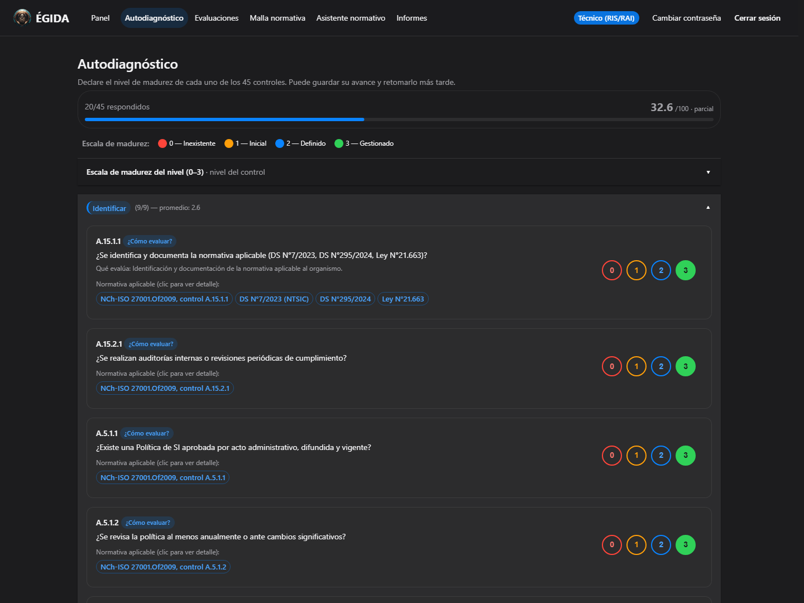
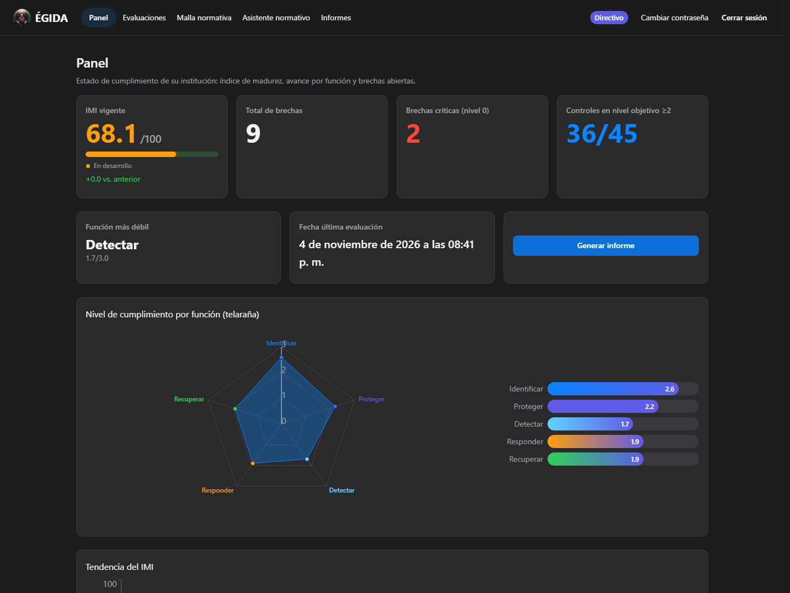
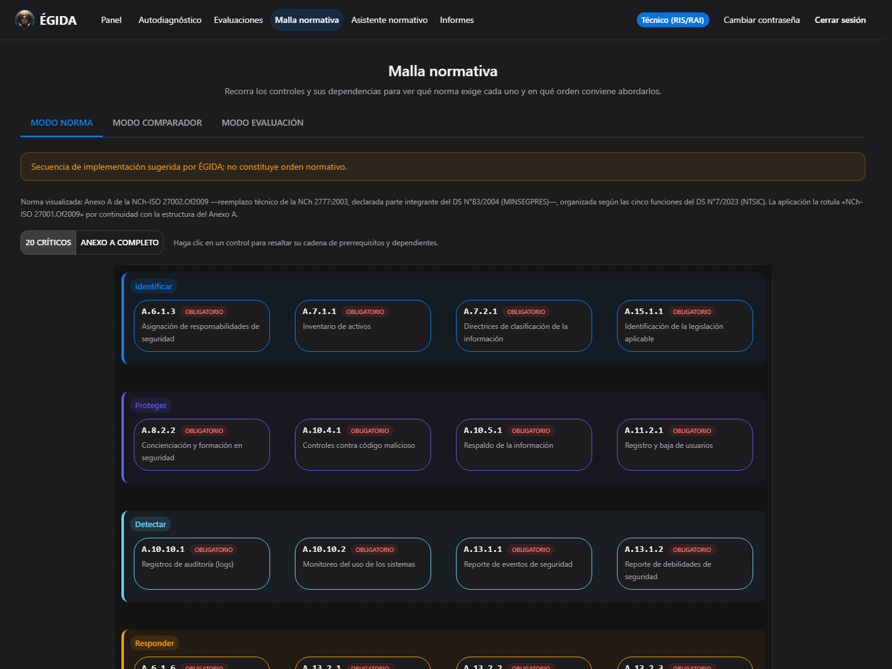
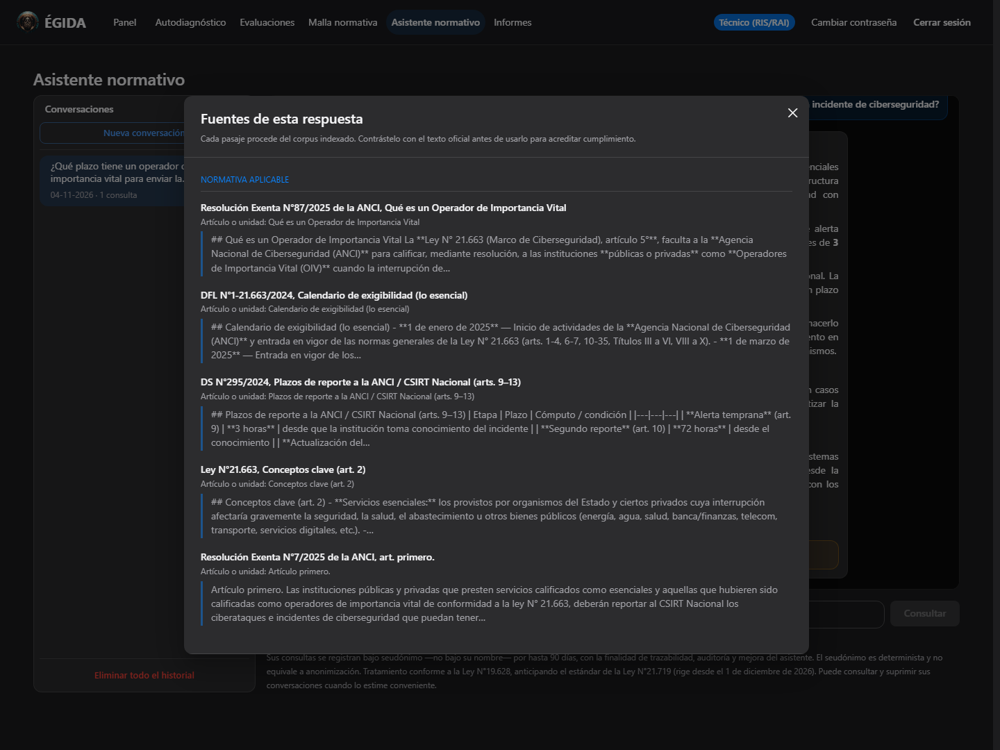
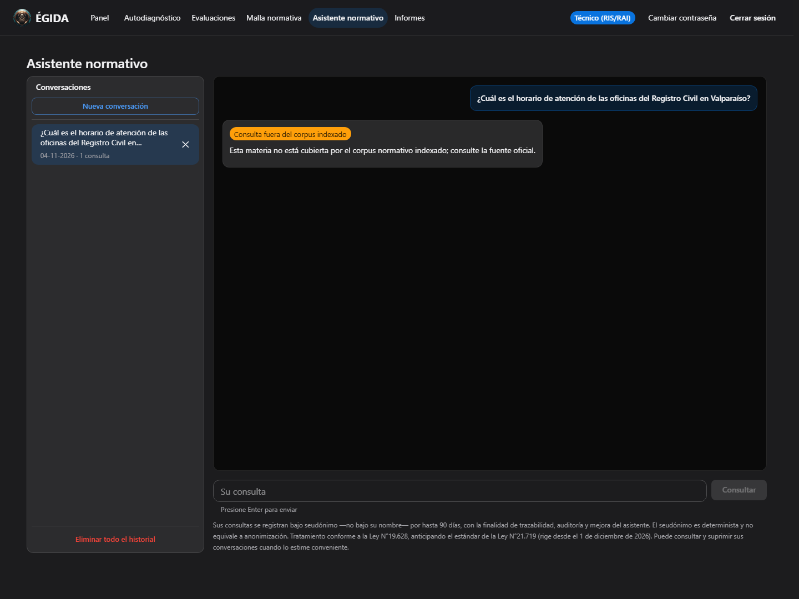

# 🛡️ ÉGIDA

**Portal de autogestión de madurez y cumplimiento en ciberseguridad para órganos de la
Administración del Estado de Chile**

[🌐 **Sistema en producción → egida.uk**](https://egida.uk) · [🧪 **MVP no-code de este repositorio →**](https://jarayaa.github.io/egida-mvp/)

*ACIF3003 — Proyecto de Innovación | Universidad Andrés Bello — Jaime Araya Aros*

---

> **Qué es este repositorio.** La cara pública del proyecto y el archivo del **MVP no-code** con
> que se validó el concepto en Fase 2. El producto vive en [egida.uk](https://egida.uk) y su
> código fuente **no es público**: ÉGIDA maneja autoevaluaciones de organismos del Estado y su
> superficie técnica se mantiene deliberadamente discreta. Aquí se describe qué hace el sistema y
> sobre qué normas se apoya, no cómo está hecho por dentro.

---

## Qué resuelve

Un organismo público chileno que debe cumplir el **DS N°7/2023 (NTSIC)** enfrenta tres preguntas
que hoy se responden con planillas: en qué estado está, qué le falta y con qué documento se
respalda ante una fiscalización. ÉGIDA las convierte en un recorrido trazable:

| | |
|---|---|
| **Autoevaluar** | 45 controles del Anexo A de la NCh-ISO 27001.Of2009, alineados a las cinco funciones NTSIC |
| **Medir** | Índice de Madurez Institucional (IMI), determinístico y reproducible |
| **Comparar** | Cuatro ediciones normativas lado a lado, con la equivalencia entre sus controles |
| **Documentar** | Informe de brechas en PDF: exigencia normativa, recomendación y plan a 30/60/90 días |
| **Consultar** | Asistente de normativa chilena que responde **con cita verificable** o declara que no tiene cobertura |

---

## El producto, en pantallas

Capturas del 4 de noviembre de 2026, tomadas de la versión de desarrollo sobre un **organismo
ficticio** («Servicio Ficticio de Demostración ÉGIDA»): ningún dato corresponde a una institución
real. La instancia publicada en [egida.uk](https://egida.uk) puede ir una versión por detrás.

**Autodiagnóstico.** Cada control con su escala de madurez 0–3 y la normativa que lo exige; el
índice parcial se recalcula a medida que se responde.

**Panel del directivo.** Índice de madurez, brechas, controles en nivel objetivo y el avance por
cada una de las cinco funciones del DS N°7/2023.

**Malla normativa.** Los controles por función, con su obligatoriedad. La secuencia es una
sugerencia de remediación del proyecto y no constituye orden normativo.

**Asistente: las fuentes de una respuesta.** Cada pasaje citado procede del corpus indexado y se
muestra para contrastarlo con el texto oficial.

**Asistente: lo que no cubre, lo declara.** Ante una consulta ajena al corpus no improvisa una
respuesta.

> Las respuestas del asistente requieren siempre validación humana: la atribución de cada
> afirmación a su fuente todavía se está endureciendo, y por eso aquí se muestran las fuentes y la
> abstención, no una respuesta redactada.

---

## Principio rector

> En el sector público la innovación solo vale si es **trazable, auditable y verificable**.

De ahí tres decisiones que atraviesan el producto:

1. **El diagnóstico y los indicadores son 100 % determinísticos.** El IMI se calcula con una
   fórmula fija sobre respuestas guardadas. No interviene un modelo de lenguaje: la misma
   evaluación da el mismo número hoy y dentro de un año.
2. **La inteligencia artificial solo asiste consulta y redacción**, siempre con cita verificable y
   con una persona en el circuito. Ante una consulta fuera de su dominio, el asistente **dice que
   no la cubre** en lugar de improvisar.
3. **Lo que el sistema no sabe, lo declara.** Es la diferencia entre una herramienta de
   cumplimiento y una que aparenta cumplir: un silencio se lee como una respuesta.

---

## Base normativa

| Instrumento | Uso en ÉGIDA |
|---|---|
| **DS N°7/2023 (NTSIC)** | Marco de los controles y de las cinco funciones |
| **DS N°295/2024** | Plazos de reporte de incidentes |
| **Res. Ex. N°7/2025 ANCI** | Taxonomía de incidentes |
| **Res. Ex. N°87/2025 ANCI** | Nómina de Operadores de Importancia Vital (905 entidades) |
| **NCh-ISO 27001.Of2009** | Controles del Anexo A: base del autodiagnóstico |
| **NCh 2777.Of2003 · NCh-ISO 27001.Of2013 · NCh-ISO/IEC 27001:2023** | Ediciones comparadas |

**Jerarquía explícita.** Solo la edición oficializada por decreto es exigible para los órganos de
la Administración del Estado; las demás son referenciales, y la pantalla lo advierte donde el
usuario podría confundirlas. Cumplir una norma referencial no acredita el cumplimiento de la
exigible, que es la que la Contraloría fiscaliza.

---

## Comparador de normativa

Cuatro instrumentos, **467 controles** y **565 correspondencias** entre ellos. Al seleccionar un
control, el comparador muestra su homólogo en la otra edición o **declara por qué no lo hay**:
porque esa edición no lo recoge, o porque el control es posterior a ella.

**La procedencia de cada correspondencia está declarada, porque no es homogénea.** La relación
entre la edición de 2013 y la de 2023 proviene del anexo de correspondencia de la propia norma.
Las demás son concordancia establecida sobre el texto —control por control— porque **no existe
tabla oficial para esos pares**: son una guía de lectura, no una equivalencia oficializada, y el
sistema lo dice en pantalla en lugar de dejar que se asuma.

---

## Cómo se verifica que funciona

El proyecto trata la verificación como parte del producto, no como un trámite posterior:

- **Cuatro capas de prueba** en cada cambio: unitaria, de integración contra base real, en
  navegador real (incluye accesibilidad WCAG 2.1 AA y nueve perfiles de red degradada) y dinámica
  contra la aplicación ya desplegada.
- **Las pruebas se juzgan por su escenario.** Una prueba que pasa con el defecto delante no es una
  prueba: se comprueba que efectivamente falle cuando el defecto está presente.
- **La verificación llega hasta el sitio publicado**, porque un dato incompleto puede desplegarse
  sin que nada falle.
- **Accesibilidad medida, no supuesta.** El contraste se calcula sobre los valores efectivos de la
  interfaz; el escaneo automático recorre también las vistas que solo se alcanzan tras un clic.

---

## El MVP no-code (Fase 2) — lo que preserva este repositorio

Antes de construir el producto se validó el concepto con un MVP **sin escribir código a mano**,
publicado aquí y todavía navegable: **[jarayaa.github.io/egida-mvp](https://jarayaa.github.io/egida-mvp/)**

| Capacidad | Detalle |
|---|---|
| 🎯 **Autodiagnóstico determinístico** | 20 controles críticos del Anexo A (4 por función NTSIC), con cálculo real del índice: **IMI = (Σ niveles / 60) × 100** |
| 🤖 **Asistente normativo (RAG)** | Cita instrumento y artículo, distingue OIV, aplica plazos con sus condiciones y rechaza consultas fuera del corpus, con advertencia de validación humana |
| 🏛️ **Enfoque de sector público** | Trazable, auditable y verificable: el diagnóstico es determinístico; la IA solo asiste |

**Resultado de la validación: 16/16 consultas respondidas con citas correctas y 0 alucinaciones.**

Cómo se construyó, que es parte del hallazgo: el portal se generó de forma **agéntica con Kiro**
—se especifica el comportamiento en lenguaje natural y el agente produce la implementación— y el
asistente es un **agente RAG de Chatbase**, genuinamente no-code y embebido en la pestaña
«Asistente». La página es autocontenida (`index.html` + `app.js`, sin manejadores en línea), se
sirve por GitHub Pages sobre HTTPS con política de contenido estricta, y conserva un modo sin
conexión con las respuestas de la validación.

### Del MVP al producto

Validado el concepto, ÉGIDA se reconstruyó como producto codificado, con alcance ampliado de 20 a
45 controles en el autodiagnóstico, informes en PDF, panel de indicadores por rol y la malla
normativa con su comparador. **El detalle técnico del producto no se publica**, por la misma razón
por la que el sistema no lo expone en sus respuestas.

---

## Enlaces

| | |
|---|---|
| 🌐 **Sistema en producción** | [egida.uk](https://egida.uk) — requiere credenciales institucionales |
| 🧪 **MVP no-code (este repositorio)** | [jarayaa.github.io/egida-mvp](https://jarayaa.github.io/egida-mvp/) |
| 🔒 **Código fuente del producto** | Repositorio privado |

Para consultas sobre el proyecto, una demostración guiada o una solicitud de acceso evaluado,
escribir al autor.

---

**ACIF3003 — Proyecto de Innovación en Ingeniería Civil Informática**

Universidad Andrés Bello | 2026

🛡️ *Bajo la égida de la ciberseguridad* 🛡️

